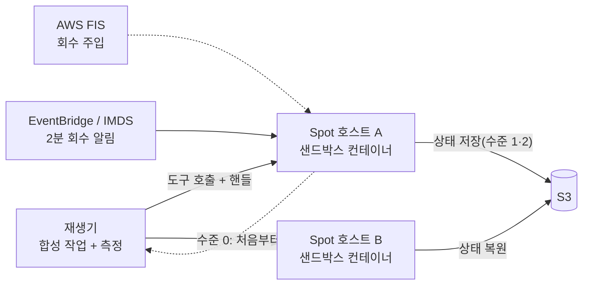

# [제안서] 상태를 가진 AI Agent 실행 환경의 Spot 100% 운영: 상태 보존 수준별 비용·성능 측정

2026-10-26 · 초안 (사용자 작성 칸 `[사용자 작성]`이 남아 있음)

> CFP 4장 형식(7개 항목 + AI 사용 내역)에 맞춘 제안서 초안입니다. 근거 자료는 `documents/`에 있고, 수치는 조건과 함께 적었습니다. 가설로 둔 목표치는 On-Demand 기준선을 잰 뒤 확정합니다.

## 작성 상태

| 항목 | 상태 |
|---|---|
| 1. 제목 / 트랙 | 제목·트랙·Reviewer 확정 (2026-10-26) |
| 2. 문제 정의 | 사용자 초안(2026-10-25)만 있음, **사용자 작성 필요** |
| 3. 목표와 최종 지표 | 초안 완료 (가설 목표치) |
| 4. 접근 방법 | 초안 완료 (제어부 위치는 확인 필요) |
| 5. 예상 비용 | 추정치 있음, **Pricing Calculator 재계산 필요 (사용자)** |
| 6. 예상 리스크 | 초안 완료 |
| 7. 학습 계획 | 항목·이유·방법·현재 수준(전부 기초) 완료 |
| AI 사용 내역 | 틀만 있음, **사용자 작성 필요** |

## 1. 제목 / 트랙

| 항목 | 내용 |
|---|---|
| 제목 (확정 2026-10-26) | 상태를 가진 AI Agent 실행 환경의 Spot 100% 운영: 상태 보존 수준별 비용·성능 측정 |
| 트랙 (확정 2026-10-26) | A. Cost Optimization (FinOps) + C. Chaos Engineering 요소(AWS FIS로 회수 주입) |
| Project Lead | 사용자 |
| Reviewer | 선수 3번, 4번 (본인은 1번 선수, CFP 순환 배정) |

## 2. 문제 정의

**`[사용자 작성]`** 3~5문장. 아래는 2026-10-25에 쓰신 초안이고, 보완할 칸 5개는 채팅에서 안내했습니다.

> 일반적인 On-demand를 사용하여 서비스를 가용했을 때, 비용이 많다. 비용을 줄이기 위해 Spot instance로 마이그레이션 할 때 Stateful 한 서비스에 대한 정보 연결성이 적다. Spot instance 자원 회수에 대해 대처해야 한다.

보완 칸: ① 대상(에이전트 실행 환경, 상태 종류) ② 현재 비용 문제 ③ Spot에서 생기는 상태 문제와 근거 수치 ④ 공개 자료의 빈칸 ⑤ 이 프로젝트가 재는 것

쓸 때 쓸 수 있는 근거 (`documents/`):
- 에이전트의 상태는 대화 + 파일 + 실행 중 프로세스이고, 대화만 복구하면 Terminal-Bench 작업의 8~13%만 성공했습니다. 처음부터 재시작하면 작업 시간이 1.55~1.81배였습니다 (Crab, arXiv 심사 전, B등급).
- 위 연구의 Spot 실험은 실제 회수가 아니라 60초 알림을 넣은 시뮬레이션이었고 호스트 1대였습니다.
- Spot에서 On-Demand와 같은 p95·가용성을 유지했다고 측정한 공개 자료는 찾지 못했습니다. SpotServe는 비용 −54%의 대가로 P99 지연이 최대 +90%였습니다 (A등급).
- 같은 인스턴스 타입·AZ의 회수는 92.9%가 3분 안에 함께 일어났습니다 (Ding-Dong Ditch, B등급).

## 3. 목표와 최종 지표

**목표:** 상태를 가진 AI Agent의 실행 환경을 On-Demand에서 Spot 인스턴스로 옮겨 인프라 비용을 줄이면서, 실제 회수 상황에서도 성능이 얼마나 유지되는지 측정한다.

1. AI Agent의 실행 환경(샌드박스)을 Spot에서 운영한다.
2. 작업 완료율, 완료 시간, 복구 시간이 On-Demand와 얼마나 다른지 측정한다.
3. 인프라 비용과 회수 때문에 늘어난 비용을 합친 총비용을 On-Demand와 비교한다.
4. 상태 보존 수준별로 비교하고, 실제 회수(AWS FIS) 환경에서 한다.

### 정량 지표 (목표치는 기준선 측정 전의 가설)

| 지표 | 정의 | 현재 | 가설 | 측정 방법 |
|---|---|---|---|---|
| 작업 완료율 | 회수가 있어도 최종 파일 상태와 검사 스크립트 결과가 회수 없는 실행과 같은 작업의 비율 | 미측정 | 수준 2에서 95% 이상 | 작업 종료 후 파일 트리 해시와 검사 결과를 기준선과 비교 |
| 완료 시간 p95 증가율 | 회수 없는 실행 대비 | 미측정 | 수준 2에서 +20% 이내 | 같은 작업을 기준선과 회수 시나리오에서 각각 반복 실행 |
| 작업당 총비용 | Spot 비용 + 저장·복구 비용 + 다시 실행한 시간의 비용, On-Demand 대비 | 미측정 | 50% 이상 절감 | 실행 시간 × 단가 + S3·FIS 비용. 단가는 가격 이력 API와 가격표 |
| (보조) 복구 시간 | 회수 알림 → 작업 재개 | 미측정 | 측정만 | 알림 수신·재개 시각 로그의 중앙값, p95 |

반복 횟수: 합성 작업 2~3종 × 수준 0·1·2 × 회수 시점(초반·중반·후반) 조합당 최소 3회, 약 60회 이상의 FIS 회수 실험을 목표로 합니다.

### 정성 지표

1. 상태 보존 수준별 trade-off 분석(어떤 상태가 필요하고 무엇이 비싼지)과 ADR
2. 회수 대응 runbook과 postmortem 1건

### Scope

| 구분 | 내용 |
|---|---|
| **Must** | 샌드박스 도구 실행 서버(핸들 기반 세션)와 Spot 호스트 풀(2~3 AZ) · 재생기와 합성 작업 2~3종 · 회수 감지(2분 알림) · 상태 보존 수준 0·1·2 · On-Demand 기준선과 회수 없는 Spot 기준선 · FIS 회수 실험(알림 120초) · 총비용 계산 · 인스턴스 선택 규칙 · IaC, README |
| **Nice to Have** | 수준 3(CRIU, 프로세스 전체) · 같은 AZ 동시 회수 · 알림 시간 30초·0초 · "Spot 100%" 정의 (b)(On-Demand fallback) 비교 · nebius 실제 기록 일부 재생 · MCP SDK 호환 · 자연 회수 관측 기록 |
| **Out of scope** | LLM 서버 Spot 운영 · SPS 분석·예측·풀 단위 조기 경보 · 다중 클라우드 · microVM(nested virtualization) · 실제 LLM을 호출하는 에이전트 운영 · 마이그레이션을 관리하는 AI Agent · 샌드박스 보안 설계 |

## 4. 접근 방법

에이전트가 MCP 도구(셸·파일·프로세스 실행)를 호출하면 실행되는 **도구 실행 서버**를 Spot 호스트에 올립니다. 서버는 상태를 핸들(세션 ID)로 보관하므로, 회수 뒤에도 핸들이 유효한지가 상태 보존의 기준이 됩니다. 모델은 호출하지 않고, 재생기가 `tools/call` 모양의 요청을 미리 정한 순서대로 보냅니다.

### 상태 보존 수준

| 수준 | 방법 | 회수 때 하는 일 |
|---|---|---|
| 0 (대조군) | 상태를 버림 | 처음부터 재실행 |
| 1 | 명령·세션 기록을 S3에 저장 | 새 호스트에서 기록을 다시 실행해 상태 재구성 |
| 2 | 기록 + 작업 디렉터리 스냅샷을 S3에 저장 | 새 호스트에 디렉터리를 복원하고 이어서 실행 |
| 3 (Nice) | 파일 + 실행 중 프로세스 전체(CRIU) | 프로세스 상태까지 복원 |

2분 안에 저장이 끝나는 크기인지는 구현하면서 잴 항목이며, 수준 1·2의 세부 방식은 구현 중에 조정합니다.

### 주요 결정 (초안)

| 결정 | 선택 | 이유 |
|---|---|---|
| 오케스트레이션 | EC2 Auto Scaling 그룹(Terraform), 호스트당 컨테이너 여러 개 | EKS는 클러스터당 $0.10/시간(한 달 약 $73)이고, 샌드박스는 컨테이너만 띄우면 됨. Karpenter·EKS는 나중에 올릴 후보 |
| 회수 감지 | 인스턴스 메타데이터(5초 간격) + EventBridge 2분 알림 | AWS 권장 방식 (`aws-spot-facts.md` 1절) |
| 회수 주입 | AWS FIS `send-spot-instance-interruptions` | 회수 대기 2~15분만 가능해서 알림 시간 변수(30초·0초)는 코드 지연과 직접 종료로 흉내 냄 |
| 인스턴스 선택 | 요구 사양 필터 → Advisor 회수 빈도 구간이 가장 낮은 것 → SPS 높은 AZ → 가격. 값은 조회만 함 | 선생님 피드백(분석 제외, 단순 선택). 서울 후보: m5a.xlarge(<5%), c5a.xlarge(5~10%) |
| 리전 | 서울(ap-northeast-2) | CLI 기본 리전이고 m5a Spot 가격이 버지니아보다 낮았음 (2026-10-25 조회) |
| 워크로드 | 합성 작업 2~3종 (실제 에이전트 기록의 통계로 모양을 맞춤) | 실제 기록은 환경 이미지가 필요하고 단계별 시간·토큰 수가 없음. 이름은 "에이전트형 워크로드 재생"으로 정직하게 씀 |
| **제어부 위치 (확인 필요)** | 대상 워크로드(샌드박스 호스트)만 Spot 100%로 하고, 재생기·측정 수집기는 실험 도구로 분리 | "Spot 100%"의 범위를 실험 도구까지 넓힐지 정해야 함 |

### AI Agent 활용 범위

- 이 프로젝트의 AI Agent는 **운영 대상 워크로드(실행 환경)** 이고, 모델은 호출하지 않습니다.
- 선생님 피드백(2026-10-16): 실행 환경을 마이그레이션하는 해석을 인정받았고, LLM 서버와 가용성 신호 분석은 지금 하지 않으며 "MCP 도구 실행환경 관점에서 시작, 직관적인 것부터 단계적으로" 올리라는 방침을 받았습니다 (`SongmhT.md`).
- 사전 학습 적용 계획: 작성하지 않기로 결정했습니다 (2026-10-16).

## 5. 예상 비용

AWS 예산은 $200 이하를 목표로 합니다. 아래는 2026-10-25 조회한 단가(서울)와 가정으로 만든 추정치이며, **Pricing Calculator 재계산은 `[사용자 작성]`** 입니다.

| 항목 | 가정 | 월 예상 비용 (USD) |
|---|---|---|
| Spot 호스트 | m5a.xlarge 4대 × 120시간 × $0.06 (7일 평균 $0.058~0.063) | 약 29 |
| On-Demand 기준선 | 2대 × 40시간 × $0.212 | 약 17 |
| FIS | 약 60회 × 5분 = 300 액션-분 × $0.10 | 약 30 |
| 공인 IPv4 | $0.005/시간 × 약 560시간 | 약 3 |
| EBS, S3, 데이터 전송 | 가격 미확인 가정 | 약 10 |
| **합계** | | **약 90 (범위 70~120)** |

- NAT Gateway는 쓰지 않는 구성이 전제입니다 (시간당 $0.045 + 처리 1GB당 $0.045, us-east-2 예시).
- Spot vCPU 할당량은 서울·버지니아 모두 32 vCPU(조정 가능)이고 On-Demand는 16 vCPU라 증설은 필요 없을 가능성이 큽니다.
- 비용 알림: AWS Budgets $50 / $100 / $150 (제안).

## 6. 예상 리스크

| 리스크 | 영향 | 대응 |
|---|---|---|
| 2분 안에 상태 저장이 안 끝남, 수준 3(CRIU) 난이도 | 수준 2·3의 복원 성공률이 낮아짐 | 수준 3은 Nice to Have로 두고, 저장 크기와 시간을 먼저 재서 한계를 결과로 남김 (CRIU는 메모리 1GB에 47.4초까지 걸림, Crab, B등급) |
| 합성 작업이 실제 에이전트를 대표하지 못함 | 결과의 일반화 주장이 약해짐 | 실제 기록의 통계(작업당 약 30단계 등)로 모양을 맞추고, 한계를 명시. 가능하면 nebius 기록 일부를 재생해 비교 |
| 일정(구현 1주)과 비용 초과 | 목표를 다 못 이룸 | Must를 수준 0~2 + FIS 실험으로 한정, Nice to Have는 버퍼로. Budgets 알림과 실험 횟수 상한 |

참고 한계: CPU 타입은 자연 회수가 드물 수 있어 FIS 중심으로 설계했고, FIS는 회수 시점을 실험자가 정합니다. 포트폴리오에는 "FIS로 AWS의 실제 회수 절차(알림·종료)를 썼지만 시점은 실험자가 정했다"고 정확히 씁니다.

## 7. 학습 계획

| 기술·서비스 | 현재 수준 | 필요한 이유 | 공부 방법 |
|---|---|---|---|
| AWS FIS (회수 주입) | 기초 | 실제 회수 절차로 실험 | 공식 문서, FIS Spot 회수 튜토리얼 |
| EC2 Auto Scaling 그룹·Spot 설정, Terraform | 기초 | Spot 호스트 풀을 IaC로 구성 | 공식 문서, 작은 그룹으로 실습 |
| 컨테이너·파일시스템 상태, (선택) CRIU | 기초 | 수준 2·3 구현 | CRIU 공식 문서, 작은 프로세스로 체크포인트 실습 |
| 에이전트 도구 호출 구조, MCP `tools/call`과 상태 핸들 | 기초 | 재생기와 핸들 기반 서버 설계 | MCP 공식 스펙(draft), 사전 학습 강좌 복습 |
| Spot 신호(Advisor, SPS, 가격 이력) 조회 | 기초 | 인스턴스 선택 규칙 | `aws-spot-facts.md`, CLI 직접 조회 |

공부한 내용은 engineering log에 `학습` tag로 남깁니다.

## AI 사용 내역

`[사용자 작성]` 받아들인 것과 버린 것, 이유를 한두 줄씩 적습니다. 아래는 Claude가 기여한 지점의 목록입니다.

| 항목 | AI(Claude)가 한 일 | 받아들인 것 / 버린 것과 이유 |
|---|---|---|
| 2. 문제 정의 | 사용자 초안에 빠진 점과 반론을 정리 | `[사용자 작성]` |
| 3. 지표·Scope | 지표 후보와 가설 목표치, Scope 초안을 제안 | `[사용자 작성]` |
| 4. 접근 방법 | 수준 설계, 오케스트레이션·인스턴스 선택 규칙 제안 | `[사용자 작성]` |
| 5. 예상 비용 | AWS CLI 읽기 전용 조회로 단가를 모으고 추정표 초안 작성 | 금액은 Pricing Calculator로 직접 재계산 예정 |

## 참고: 큰 일정

| 구간 | 기간 | 상태 |
|---|---|---|
| 제안서 | ~ 10-26 | 이 문서 |
| 구현 | 10-27 ~ 11-02 | 시작 예정 |
| 실험·정리 | 11-03 ~ 11-09 | |
| 목표 종료 | 11-15 (연장안) 또는 11-08 | 사용자 결정 |
| 최종 마감 | 11-30 | |
