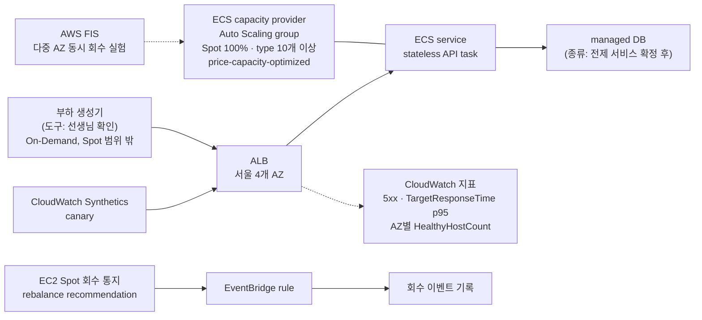

# [제안서 초안] Spot 100% 운영 프로젝트

2026-10-10 · 상태: 초안 (선생님 피드백 전)

> 표기: **[확정]** 결정됨 · **[미정]** 아직 정하지 않음 · **[선수 작성]** CFP 4장 규칙상 선수가 직접 써야 함 · **[AI 제안]** AI가 근거와 함께 제안했고 선수 확인이 필요함
>
> CFP 4장: 문제 정의(2번)와 목표(3번)는 선수가 먼저 초안을 쓰고, AI는 빠진 점과 반론을 찾는 데만 쓴다. 그래서 2·3번은 선수 초안을 그대로 두고 리뷰 의견만 따로 붙였다.

## 0. 진행 현황

| 항목 | 상태 | 남은 일 |
|---|---|---|
| 1. 제목 / 트랙 | 트랙 [확정], 제목 [미정] | 제목 짓기 (선수 번호는 표기하지 않아도 됨) |
| 2. 문제 정의 | [선수 작성] 초안 있음 | 리뷰 의견 반영해 3–5문장으로 정리. 전제 서비스는 선생님 확인 |
| 3. 목표와 최종 지표 | 지표 3개·p95 측정 방식·측정 기간 [확정], 목표 문장·정성 지표·Scope [선수 작성] | 선수 작성 부분 채우기 |
| 4. 접근 방법 | 플랫폼·리전·AI Agent [확정], diagram 초안 있음 | 전제 서비스·부하 생성 도구는 선생님 확인 |
| 5. 예상 비용 | [미정] | 전제 서비스·부하 도구 확정 후 AWS Pricing Calculator로 직접 계산 |
| 6. 예상 리스크 | [AI 제안] 초안 | 선수 검토 |
| 7. 학습 계획 | [선수 작성] 후보 목록만 있음 | 현재 수준·공부 방법 작성 |
| AI 사용 내역 | [AI 제안] 초안 | 선수 확인·수정 |

## 1. 제목 / 트랙

| 항목 | 내용 |
|---|---|
| 제목 | **[미정]** |
| 트랙 | **[확정]** A. Cost Optimization (FinOps), 예시 주제 "Spot 100% 운영" |

CFP 원문 주제: 상시 트래픽이 있는 web 서비스의 compute를 전부 Spot으로 옮기면서 가용성 99.9%, p95 300 ms를 지킨다. 여러 AZ에서 Spot 회수가 동시에 일어나도 견뎌야 한다.

## 2. 문제 정의 [선수 작성]

### 선수 초안 (원문 그대로)

- 출발점 : 클라우드 서비스를 사용하는 회사에서는 비용 문제를 중요하게 생각하고, FinOps 분야에 관심을 두는 회사가 많기 때문에. 비용
- 전제: 어떤 서비스를 어떤 상태로 운영한다고 가정하나? ← 이게 중요할 것 같은데 이걸 선생님께 물어보면서 하는 게 좋을듯
- 어려운 점: 잘 모르겠음. 공부해 보아야 함.
- 효과: 좋은 성능을 유지하지만, 기존보다 적은 비용이 들것 같다.

### 리뷰 의견 (AI)

- **출발점**: 이 주제를 고른 동기이지 풀려는 문제가 아니다. "그래서 무엇이 문제인가?"라는 질문을 받을 수 있다. 아래 참고 사실의 할인 폭과 그 할인을 쓰기 어려운 이유를 연결하면 문제가 된다.
- **전제 [미정]**: 선생님께 확인하는 것은 좋다. 다만 답을 기다리면 늦어지므로 후보를 직접 정해 "이렇게 하려는데 괜찮을까요?"로 묻는 편이 빠르다. 후보 예: 직접 만든 간단한 stateless API + managed DB, 또는 공개된 샘플 web 앱.
- **어려운 점**: 비어 있으면 제안서가 가장 약해 보인다. 아래 참고 사실 중 본인이 이해한 것을 골라 본인 말로 쓴다.
- **효과**: "~것 같다"는 측정할 수 없다. 3번 지표 숫자와 연결한다.

### 참고 사실 (공식 문서로 확인함)

- Spot은 On-Demand 대비 **최대 90%** 저렴하다. On-Demand와 다른 점은 AWS가 **2분 전 통지 후 회수**할 수 있다는 것 하나다. ([Spot best practices](https://docs.aws.amazon.com/AWSEC2/latest/UserGuide/spot-best-practices.html))
- 다만 실제 할인 폭은 type마다 다르다. 2026-10-10 기준 [Spot Instance Advisor](https://aws.amazon.com/ec2/spot/instance-advisor/) 데이터를 보면, 서울 리전 Linux의 웹 서버용 large·xlarge 34종은 할인율이 **58~72%이고 중앙값은 64%**다. Advisor 수치는 최근 30일 기준이며 미래를 보장하지 않는다.
- AWS는 Spot 용량을 **보장하지 않는다**. 목표 용량을 일시적으로 다 채우지 못하는 상황을 견디지 못하는 workload에는 Spot을 권하지 않는다. 회수 시 On-Demand로 넘어가는 방식은 **강하게 말린다**. (같은 문서)
- AWS가 Spot에 맞다고 꼽는 대상에 stateless web server가 있다. stateful workload에는 맞지 않는다. (같은 문서)
- ALB target group의 deregistration delay 기본값은 300초로, 2분 통지보다 길다. ([target group 속성](https://docs.aws.amazon.com/elasticloadbalancing/latest/application/edit-target-group-attributes.html))

## 3. 목표와 최종 지표

### 목표 한 문장 [선수 작성]

선수 초안: 기존보다 비용 엄청 줄이기. 성능의 문제는 거의 없게 만들기.

리뷰 의견 (AI): "엄청", "거의 없게"로는 달성 여부를 판단할 수 없다. CFP가 가장 중요하게 보는 것이 측정 방법이므로 아래 숫자 세 개(99.9%, 300 ms, 50%)가 목표 문장에 들어가야 한다.

### 정량 지표

| 지표 | 현재 (기준선) | 목표 | 측정 방법 |
|---|---|---|---|
| 가용성 | 기준선 기간에 On-Demand로 측정 **[확정]** | **99.9% [확정]** · 도전 목표 99.99% (측정·보고만) **[확정]** | 외부 확인(Synthetics) + ALB 오류율 + 부하 생성기 결과를 모두 사용 **[확정]**. 아래 측정 방법 부록 참고 |
| p95 latency | 기준선 기간에 측정 **[확정]** | **300 ms [확정]** | 부하 생성기가 잰 **client 쪽 p95를 공식 지표**로 한다 **[확정]**. ALB `TargetResponseTime` p95는 원인 분석용으로 함께 기록 |
| compute 비용 절감률 | 기준선 기간의 On-Demand compute 월 비용 **[확정]** | **50% [확정]**, 성능 유지 우선 | Cost Explorer Purchase option 필터 + Project tag로 기준선과 Spot 기간을 비교 |

- **가용성 허용 시간**: 99.9%는 연간 약 8시간 45분, 30일 기준 약 43분, 4주 기준 약 40분이다. 99.99%는 연간 약 53분, 30일 기준 약 4.3분, 4주 기준 약 4분이다. 측정 기간은 몇 주 단위이므로 **측정 기간 기준 허용 시간**으로 적는다.
- **측정 기간 [확정]**: 기준선(On-Demand) 2주 → Spot 4주. Spot 4주 기준 허용 중단 시간은 99.9%에서 약 40분, 99.99%에서 약 4분이다.
- **전체 비용 절감률**: ALB, DB처럼 Spot이 아닌 부분은 절감률을 희석한다. 그래서 측정은 하되 목표 숫자는 Pricing Calculator 계산 후 정한다. **[미정]**

### 99.99%를 공식 목표로 두지 않는 이유 (계산 근거)

[Well-Architected 가용성 계산법](https://docs.aws.amazon.com/wellarchitected/latest/reliability-pillar/availability.html)에 따르면, 하나가 멈추면 서비스도 멈추는 의존성(hard dependency)이 있을 때 전체 가용성은 각 가용성의 **곱**이다. AWS 예시: 99.99% 시스템이 99.99% 의존성 2개를 쓰면 이론상 약 99.97%가 된다.

요청은 ALB → app(Spot) → DB 순서로 지나간다. [Appendix A의 설계상 가용성](https://docs.aws.amazon.com/wellarchitected/latest/reliability-pillar/appendix-a-designed-for-availability-for-select-aws-services.html)(ELB 99.99%, Multi-AZ DB 99.99%)을 넣으면 다음과 같다.

```text
ALB(99.99%) × app(100% 가정) × DB Multi-AZ(99.99%) ≈ 99.98%
ALB(99.99%) × app(99.99%)    × DB Multi-AZ(99.99%) ≈ 99.97%
```

- app 계층을 완벽하게 만들어도 이론상 상한이 약 99.98%다. 그래서 99.99%는 설계로 달성한다고 주장할 수 없다.
- 4주 기준 허용 시간이 약 4분이라, 동시 회수를 한 번만 잘못 처리해도 넘는다.
- [99.99% 참조 설계](https://docs.aws.amazon.com/wellarchitected/latest/reliability-pillar/s-99.99-scenario.html)는 On-Demand 기준으로 AZ 3개에 각각 최대 부하의 50%를 둔다. Spot의 여러 AZ 동시 회수까지 여유 용량으로 막으면 절감률이 28%로 떨어져(아래 표) 50% 목표와 충돌한다.
- 다만 Appendix A 수치는 설계 목표값이고 실제 측정값이 아니다. 그래서 99.99%는 공식 목표가 아니라 **측정해서 보고하는 도전 목표**로 둔다.

### 절감률 50% 달성 조건 (계산 근거)

[Well-Architected REL11-BP05](https://docs.aws.amazon.com/wellarchitected/latest/framework/rel_withstand_component_failures_static_stability.html)는 AZ 하나가 사라져도 버틸 만큼 각 AZ에 instance를 미리 띄워 두라고 권한다. 같은 문서는 **AZ를 더 많이 쓸수록 필요한 여유 용량이 줄어든다**고도 적고 있다. 서울 리전은 AZ가 4개다. ([AWS Regions](https://docs.aws.amazon.com/global-infrastructure/latest/regions/aws-regions.html))

할인율 64%(Advisor 중앙값)를 기준으로 계산하면 다음과 같다.

| 버틸 상황 | 필요 여유 용량 | Spot 비용 (On-Demand 대비) | 절감률 | 50% 달성 |
|---|---|---|---|---|
| 여유 없음 | 1배 | 36% | 64% | O (회수 시 성능 저하 위험) |
| 4개 AZ 중 1개 회수 | 1.33배 | 48% | **52%** | **O** |
| 3개 AZ 중 1개 회수 | 1.5배 | 54% | 46% | X |
| 4개 AZ 중 2개 동시 회수 | 2배 | 72% | 28% | X |

- 50%를 지키려면 **여유 용량이 1.39배 이하**여야 한다. 그래서 **서울 4개 AZ를 모두 쓰는 구성**이 사실상 전제가 된다.
- 여러 AZ 동시 회수를 여유 용량만으로 막으면 50%를 지킬 수 없다. 이 경우는 다른 instance type·AZ로 빠르게 교체하는 설계로 보완해야 하며, 이 trade-off가 프로젝트의 핵심 난제다.
- 1.33배 같은 여유 용량 배수는 Well-Architected의 AZ 장애 원칙을 Spot 회수에 적용한 계산이다. AWS가 Spot에 대해 직접 제시한 수치는 아니다.

### 정성 지표 [선수 작성]

선수 초안 (원문 그대로):

- 운영자가 개입하지 않아도 고가용성을 유지하며 서비스가 안정적으로 작동하는가?
- 트래픽 전환 후에도 사용자 경험을 유지하는가?
- 장애 상황에서도 서비스 연속성을 확보하는가?

리뷰 의견 (AI):

- CFP는 정성 지표를 1–2개로 요구하는데 지금은 3개다.
- "고가용성 유지"와 "서비스 연속성"은 정량 지표인 가용성 99.9%와 겹친다.
- "트래픽 전환"이 On-Demand → Spot 이전 시점인지, 회수 시 다른 instance로 넘어가는 순간인지 불분명하다.
- "운영자 개입 없이"는 "운영 기간 중 수동 개입 0회"처럼 정량으로 바꿀 수 있다.
- CFP의 A 트랙 정성 예시는 "절감 결정별 trade-off 분석, 비용 구조를 설명하는 dashboard·보고서"다. 이 프로젝트라면 "여유 용량 배수와 비용의 trade-off 분석"이나 "FIS 실험별 가설·결과 기록"이 이에 해당한다.

### Scope [선수 작성]

- Must: **[미정]**
- Nice-to-have: **[미정]** · [AI 제안] 가용성 99.99% 달성 여부 측정과 분석
- Out of scope: **[미정]**

참고: compute 범위 **[AI 제안]**. 근거는 Spot best practices와 [REL05-BP06 (stateless)](https://docs.aws.amazon.com/wellarchitected/latest/framework/rel_mitigate_interaction_failure_stateless.html)다.

| 구분 | 예시 | 범위 |
|---|---|---|
| web/app 계층 | 컨테이너, EC2 instance | **포함, 전부 Spot** |
| 데이터 | RDS/Aurora, DynamoDB | 제외 (managed) |
| 세션·캐시 | ElastiCache, DynamoDB | 제외. 앱이 로컬에 상태를 두지 않게 함 |
| 부하 생성기·측정 도구 | 부하 도구, CloudWatch Synthetics | 제외 (On-Demand 또는 managed). 측정 도구가 회수되면 장애와 측정 공백을 구분할 수 없음 |
| 진입점 | ALB 등 | 제외 (managed) |

## 4. 접근 방법

### 확정된 방향

- **[확정]** 상시 트래픽은 부하 생성 도구로 만든다.
- **[확정]** 같은 서비스를 먼저 On-Demand로 운영해 기준선(비용·가용성·p95)을 측정한 뒤 Spot 100%로 전환한다.
- **[확정]** 절감률 목표 50%, 성능(99.9%, p95 300 ms) 유지를 우선한다.
- **[확정]** 측정 순서: 기준선(On-Demand) 2주 → Spot 100% 4주.

### 결정 현황

| 항목 | 상태 | 비고 |
|---|---|---|
| 실행 플랫폼 | **[확정]** B. ECS on EC2 (Auto Scaling group capacity provider, Spot 100%) | 아래 후보 비교 참고 |
| 리전 | **[확정]** 서울 ap-northeast-2, AZ 4개 모두 사용 | 절감률 50% 계산의 전제 |
| AI Agent | **[확정]** 사용하지 않음 | A 트랙에서는 선택 사항. 핵심 목표(가용성·절감률)에 집중 |
| 전제 서비스 (무엇을 운영할지) | **[선생님 확인 필요]** | 후보: 직접 만든 stateless API + managed DB, 또는 공개된 샘플 web 앱 |
| 부하 생성 도구 | **[선생님 확인 필요]** | 후보: k6(서버 1대에서 상시 실행), [Distributed Load Testing on AWS](https://docs.aws.amazon.com/solutions/latest/distributed-load-testing-on-aws/solution-overview.html)(JMeter·k6·Locust 지원), Locust |
| 사전 학습 적용 계획 | 필수 강좌 4개 수강 완료 **[확정]**, 강좌별 적용 계획 **[선수 작성]** | Agent를 쓰지 않으므로 AI coding tool 사용과 검증 방식에 적용 |

### Architecture diagram (초안)

전제 서비스와 부하 생성 도구가 정해지면 해당 부분을 구체화한다.



- 회수 처리: ECS managed instance draining(기본 활성)이 회수 대상 instance를 draining으로 바꾸고, 새 task를 먼저 띄운 뒤 기존 task를 멈춘다.
- 여유 용량: 4개 AZ 중 1개가 회수돼도 버티도록 1.33배를 기준으로 시작한다. 여러 AZ 동시 회수는 FIS로 실험해 결과를 분석한다.
- 비용 측정: Cost Explorer의 Purchase option과 Project tag로 기준선과 Spot 기간을 비교한다.

### 실행 플랫폼 후보 (비교 기록)

| | A. ASG+ALB | B. ECS on EC2 | C. Fargate Spot | D. EKS 관리형 노드 그룹 | E. EKS+Karpenter |
|---|---|---|---|---|---|
| 회수 시 처리 주체 | 직접 구현 | ECS managed instance draining (기본 활성, 새 task 먼저 실행) | ECS가 재시도. 용량 없으면 대기 | EKS가 cordon·drain (best effort) | Karpenter (SQS·EventBridge 직접 구성) |
| instance 다변화 직접 제어 | O | O | X | O | O |
| FIS로 Spot 회수 재현 | O | O | X (FIS action 대상이 EC2 Spot instance) | O | O |
| 추가 고정비 | 없음 | 없음 (ECS orchestration 무료) | 없음 | 약 $73/월 (cluster $0.10/시간) | 약 $73/월 |

- **B를 선택 [확정]**. AI 추천 근거: 회수 시 draining을 AWS가 관리하고, 다변화와 FIS 실험이 가능하며, 고정비가 없다. Kubernetes 경험이 채용에 더 유리할 가능성은 확인하지 못했다.
- 근거 문서: [managed instance draining](https://docs.aws.amazon.com/AmazonECS/latest/developerguide/managed-instance-draining.html), [Fargate capacity providers](https://docs.aws.amazon.com/AmazonECS/latest/developerguide/fargate-capacity-providers.html), [EKS managed node groups](https://docs.aws.amazon.com/eks/latest/userguide/managed-node-groups.html), [EKS Karpenter](https://docs.aws.amazon.com/eks/latest/best-practices/karpenter.html), [EKS 요금](https://aws.amazon.com/eks/pricing/), [ECS 요금](https://aws.amazon.com/ecs/pricing/)

### Spot 설정 원칙 (AWS 권장. 근거 확인됨, B의 Auto Scaling group에 적용)

- 하나의 workload에 instance type을 **10개 이상** 쓰고, VPC의 **모든 AZ**를 사용한다.
- 할당 전략은 `price-capacity-optimized`로 한다. **API·CloudFormation 기본값은 `lowest-price`**라서 IaC에서 직접 지정해야 한다. ([InstancesDistribution](https://docs.aws.amazon.com/autoscaling/ec2/APIReference/API_InstancesDistribution.html))
- 최고 가격(max price)은 회수를 늘릴 수 있어서 설정하지 않는다.
- Capacity Rebalancing을 켠다. rebalance recommendation과 회수 통지는 EventBridge로 받는다. ([rebalance recommendations](https://docs.aws.amazon.com/AWSEC2/latest/UserGuide/rebalance-recommendations.html))
- ALB deregistration delay를 2분보다 짧게 줄인다. 앱은 SIGTERM을 받으면 정상 종료하도록 만든다.
- Spot placement score로 리전·AZ의 용량 확보 가능성을 확인한다. 결과는 그 시점의 추정이며 보장이 아니다.

## 5. 예상 비용 [미정]

전제 서비스와 부하 생성 도구가 정해진 뒤 AWS Pricing Calculator로 직접 계산한다. 포함할 항목은 다음과 같다.

| 항목 | 비고 |
|---|---|
| compute (기준선 2주: On-Demand) | ECS용 EC2 instance |
| compute (Spot 4주) | 여유 용량 배수(1.33배)를 반영. ECS orchestration 자체는 무료 |
| ALB | |
| DB 등 managed 서비스 | 전제 서비스가 정해진 뒤 |
| 부하 생성기 | DLT 기본 비용 추정(월 약 $30.90)은 테스트 30시간 기준이라, 24시간 상시 부하는 따로 계산해야 함 ([DLT Cost](https://docs.aws.amazon.com/solutions/latest/distributed-load-testing-on-aws/cost.html)) |
| CloudWatch Synthetics, 지표·알람 | |
| AWS FIS 실험 | |

## 6. 예상 리스크 [AI 제안, 선수 검토 필요]

| 리스크 | 영향 | 대응 |
|---|---|---|
| Spot 용량 부족 (AWS가 보장하지 않음) | 목표 용량을 채우지 못해 가용성·p95 저하 | instance type 10개 이상과 4개 AZ로 다변화, placement score 확인. On-Demand로 넘어가는 방식은 AWS 권고에 따라 쓰지 않음 |
| 여러 AZ 동시 회수 | 여유 용량만으로는 50% 절감과 양립 불가 | 일부는 여유 용량(1.33배), 나머지는 다른 pool로 빠르게 교체. FIS로 실험해 검증 |
| 절감률 50%와 여유 용량의 충돌 | 성능을 우선하면 절감률 미달 | 결정별 trade-off를 기록. CFP상 미달성도 분석하면 평가 대상 |
| 회수 시 요청 실패 | ALB 기본 deregistration delay 300초 > 2분 통지라 5xx 발생 가능 | delay 단축, SIGTERM 처리 |
| 측정 비용과 공정성 | 상시 부하·canary 비용 증가. 기준선과 Spot 기간의 조건이 다르면 비교 무효 | 같은 부하 프로필로 두 기간 측정, 측정 도구는 Spot 범위 밖 |

## 7. 학습 계획 [선수 작성]

현재 수준과 공부 방법은 선수 본인만 알 수 있으므로 비워 둔다. 기술 후보와 공식 문서만 정리했다.

| 기술·서비스 | 현재 수준 | 필요한 이유 | 공부 방법 |
|---|---|---|---|
| EC2 Spot (회수, rebalance, 할당 전략) | **[선수 작성]** | 프로젝트 핵심 | [Spot best practices](https://docs.aws.amazon.com/AWSEC2/latest/UserGuide/spot-best-practices.html) |
| Auto Scaling mixed instances policy | **[선수 작성]** | instance 다변화 | **[선수 작성]** |
| ECS capacity provider, managed instance draining | **[선수 작성]** | 회수 시 draining | [managed instance draining](https://docs.aws.amazon.com/AmazonECS/latest/developerguide/managed-instance-draining.html) |
| ALB target group·지표 | **[선수 작성]** | 회수 시 요청 처리, 가용성·p95 측정 | [ALB 지표](https://docs.aws.amazon.com/elasticloadbalancing/latest/application/load-balancer-cloudwatch-metrics.html) |
| AWS FIS | **[선수 작성]** | 여러 AZ 동시 회수 재현 | [FIS Spot 회수 튜토리얼](https://docs.aws.amazon.com/fis/latest/userguide/fis-tutorial-spot-interruptions.html) |
| CloudWatch Synthetics | **[선수 작성]** | 외부에서 가용성 측정 | [canary 지표](https://docs.aws.amazon.com/AmazonCloudWatch/latest/monitoring/CloudWatch_Synthetics_Canaries_metrics.html) |
| Cost Explorer / CUR 2.0 | **[선수 작성]** | 절감률 측정 | [Cost Explorer 필터](https://docs.aws.amazon.com/cost-management/latest/userguide/ce-filtering.html) |

## 부록. 측정 방법

### 가용성

| 방법 | 보는 것 | 주의 |
|---|---|---|
| CloudWatch Synthetics canary | 주기적으로 실제 요청을 보내 `SuccessPercent`, `Duration` 기록. API canary는 HTTP step별 2xx·4xx·5xx도 기록 | 표본 방식이라 짧은 장애는 놓칠 수 있음 (추론) |
| ALB 오류율 | 요청 기준 성공률 | ALB 지표는 트래픽이 있을 때만 기록됨. 상시 부하가 측정 공백을 막음 |
| 부하 생성기 결과 | 사용자가 실제로 받은 결과 기준 성공률 | ALB까지 도달하지 못한 실패도 잡힘 (추론) |

ALB 성공률 공식:

```text
성공률 = 1 − (HTTPCode_ELB_5XX_Count + HTTPCode_Target_5XX_Count) ÷ (RequestCount + HTTPCode_ELB_5XX_Count)
```

`RequestCount`는 target을 고르기 전에 거부된 요청을 세지 않는다. 그래서 healthy target이 하나도 없는 순간(동시 회수)의 실패를 포함하려고 분모에 `HTTPCode_ELB_5XX_Count`를 더한다. ([ALB 지표](https://docs.aws.amazon.com/elasticloadbalancing/latest/application/load-balancer-cloudwatch-metrics.html), 공식 자체는 이 문서를 바탕으로 유도한 것)

### p95 latency

| 방법 | 재는 구간 |
|---|---|
| 부하 생성기 client 쪽 p95 | 사용자 입장의 전체 왕복 |
| ALB `TargetResponseTime` p95 (percentile 통계 지원) | ALB가 요청을 보낸 뒤 target이 응답 헤더를 보내기 시작할 때까지 |
| Synthetics `Duration` | canary 실행 한 번에 걸린 시간 |

### 비용

- 기준선(On-Demand)과 Spot 기간을 같은 부하로 운영해 비교한다.
- Cost Explorer의 Purchase option(Spot / On-Demand) 필터와 Project tag를 쓴다.
- CUR 2.0 + Athena로 상세 분석한다. Spot이 CUR에 어떤 값으로 찍히는지는 공식 문서로 확인하지 못했으므로 실제 데이터로 확인한다.
- compute 절감률과 전체 절감률을 따로 보고한다.

### 여러 AZ 동시 회수

- AWS FIS `aws:ec2:send-spot-instance-interruptions`로 여러 AZ의 instance를 tag로 지정해 동시에 회수한다. tag 지정 시 기본값으로 실험당 5대까지 가능하며 한도는 늘릴 수 있다. ([FIS Actions reference](https://docs.aws.amazon.com/fis/latest/userguide/fis-actions-reference.html))
- 실험 중 5xx 개수, p95, AZ별 `HealthyHostCount`가 회복되기까지 걸린 시간을 기록한다.
- 운영 기간에 실제로 일어난 회수 통지와 rebalance 신호도 EventBridge rule로 기록한다.

## AI 사용 내역 [AI 제안, 선수 확인 필요]

CFP 4장 요건이다. "받아들인 것 / 버린 것과 이유"는 선수가 확인해 본인 말로 고친다.

| 항목 | AI를 쓴 방식 | 받아들인 것 / 버린 것과 이유 |
|---|---|---|
| 주제 선정 | 주제 후보를 제안받음 (AI 기능 FinOps, 비용 이상 차단 등) | AI 추천과 다르게 Spot 100% 운영을 선택. 이유: **[선수 작성]** |
| 비용 절감률 | Spot Instance Advisor 데이터와 static stability 계산으로 45%를 제안받음 | 50%로 결정. 이유(선수 발언): 공식 문서의 최대 90% 할인을 보고, 50%로 잡고 성능을 유지하는 방향이 좋다고 판단. 4개 AZ 구성이면 계산상 52%로 달성 가능 |
| 가용성 목표 | 99.99% 상향이 가능한지 검토를 요청함. 의존성 곱셈 계산으로 이론상 상한 약 99.98%라는 답을 받음 | 99.9%를 공식 목표로 유지하고 99.99%는 도전 목표(측정·보고)로 추가. 이유: **[선수 작성]** |
| compute 범위 | 공식 문서 기반으로 범위를 제안받음 | **[선수 작성]** (채택 여부) |
| 2·3번 초안 | 선수 초안에 대한 반론과 빠진 점을 받음 | **[선수 작성]** (반영한 것과 버린 것) |
| 측정 방법·플랫폼 조사 | 공식 문서 조사와 비교를 받음 | **[선수 작성]** |
| 플랫폼·리전·p95·측정 기간 | 근거와 함께 추천안을 받음 (B. ECS on EC2, 서울, client 쪽 p95, 기준선 2주 + Spot 4주) | 추천안을 모두 채택. 이유: **[선수 작성]** |
| AI Agent 사용 여부 | 사용 시 필요한 작업(Bedrock 비용 한도, Agent 없는 구현과 비교)을 안내받음 | 사용하지 않기로 결정. 이유: **[선수 작성]** |
| 전제 서비스·부하 생성 도구 | 후보를 제안받음 | AI 추천으로 정하지 않고 선생님께 확인하기로 함 |

## 미정 항목 체크리스트

- [ ] 제목
- [x] 선수 번호: 표기하지 않아도 됨
- [ ] 전제 서비스: 선생님께 확인
- [ ] 2번 문제 정의: 리뷰 반영해 3–5문장으로
- [ ] 3번 목표 한 문장, 정성 지표(1–2개), Scope
- [x] p95 공식 측정 방식: client 쪽 p95
- [x] 측정 기간: 기준선 2주 + Spot 4주
- [x] 리전: 서울 (AZ 4개)
- [x] 실행 플랫폼: B. ECS on EC2
- [ ] 부하 생성 도구: 선생님께 확인
- [x] Architecture diagram 초안 (전제 서비스·부하 도구 확정 후 보완)
- [x] AI Agent: 사용하지 않음
- [ ] 사전 학습 적용 계획: 4개 수강 완료, 강좌별 적용 계획 작성 필요
- [ ] 5번 예상 비용: 전제 서비스·부하 도구 확정 후 Pricing Calculator로 계산
- [ ] 6번 리스크, 7번 학습 계획 검토·작성
- [ ] AI 사용 내역 확인

## 선생님께 확인할 것

- 제출이 늦은 점과 제출 예정 시점
- 전제 서비스 후보가 괜찮은지
- 부하 생성 도구를 무엇으로 할지

제출용 문서는 같은 폴더의 `SUBMISSION.md`다. 이 파일은 작업 기록용으로 유지한다.
