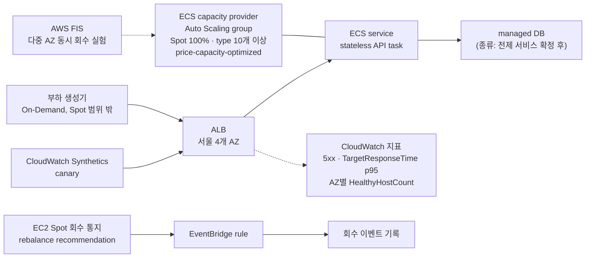

# Spot 100%이지만, 성능은 유지한 서비스 구축

2026-10-10 · 트랙 A. Cost Optimization (FinOps)

## 1. 제목 / 트랙

| 항목 | 내용 |
|---|---|
| 제목 | Spot 100%이지만, 성능은 유지한 서비스 구축 |
| 트랙 | A. Cost Optimization (FinOps), 예시 주제 "Spot 100% 운영" |

## 2. 문제 정의

Spot 인스턴스를 사용하면 할인율이 좋지만, 그만큼 쉽게 인스턴스를 뺏길 수 있습니다. 즉, 짧은 시간 내에 일시 중지하거나 다른 인스턴스로 전환할 수 없는 애플리케이션은 Spot 인스턴스에서 실행하기 어렵습니다. 또한 요금 책정이 불확실할 수 있습니다.

해결하면 얻는 것: 비용이 낮아집니다. 비용이 낮아져도 가용성과 성능은 유지됩니다.

## 3. 목표와 최종 지표

**목표**: 가용성 99.9%, p95 300 ms, 비용 절감률 50%

### 정량 지표

| 지표 | 현재 (기준선) | 목표 | 측정 방법 |
|---|---|---|---|
| 가용성 | On-Demand 기준선 2주 동안 측정 | 99.9% (도전 목표 99.99%는 측정·보고) | CloudWatch Synthetics canary, ALB 오류율, 부하 생성기 성공률을 함께 사용 |
| p95 latency | 기준선 2주 동안 측정 | 300 ms | 부하 생성기가 잰 client 쪽 p95 (ALB `TargetResponseTime` p95는 원인 분석용) |
| compute 비용 절감률 | 기준선 기간의 On-Demand compute 비용 | 50% | Cost Explorer의 Purchase option(Spot/On-Demand) 필터와 Project tag로 기준선과 Spot 기간 비교 |

- **측정 기간**: 기준선(On-Demand) 2주 → Spot 100% 4주. Spot 4주 기준 허용 중단 시간은 99.9%에서 약 40분입니다.
- **ALB 성공률**: `1 − (ELB_5XX + Target_5XX) ÷ (RequestCount + ELB_5XX)`. `RequestCount`는 target을 고르기 전에 거부된 요청을 세지 않으므로, 동시 회수로 healthy target이 없는 순간까지 포함하려고 분모에 `ELB_5XX`를 더합니다.
- **절감률 50%의 근거**: 서울 리전 웹 서버용 34개 instance type의 Spot 할인율 중앙값은 64%입니다(Spot Instance Advisor, 2026-10-10 기준). 4개 AZ 중 1개가 회수돼도 버티도록 여유 용량을 1.33배로 두면 Spot 비용은 On-Demand의 약 48%, 즉 52% 절감이 됩니다(Well-Architected REL11-BP05의 static stability 적용).
- **99.99%를 공식 목표로 두지 않는 이유**: hard dependency의 가용성은 곱으로 계산합니다(Well-Architected Reliability Pillar). ALB(99.99%) × DB Multi-AZ(99.99%)만으로 이론상 상한이 약 99.98%입니다.

### 정성 지표

- 장애 상황에서도 서비스 연속성 확보
- 트래픽 전환 후에도 사용자 경험 유지
- 운영자 수동 개입 없이 복구 가능한 구조

### Scope

- **Must**
  1. On-Demand 기준선 2주 운영·측정
  2. web/app 계층 compute를 Spot 100%로 전환해 4주 운영 (ECS on EC2, 서울 4개 AZ, instance type 10개 이상, `price-capacity-optimized`)
  3. 회수 대응 구현 (managed instance draining, SIGTERM 처리, ALB deregistration delay 단축)
  4. 측정 체계 구축 (Synthetics, ALB 지표, client 쪽 p95, Cost Explorer)
  5. AWS FIS로 여러 AZ 동시 회수 실험과 결과 분석
- **Nice-to-have**: 가용성 99.99% 달성 여부 측정·분석, 여유 용량 배수별(1배 vs 1.33배) 비용·가용성 비교, 비용·가용성 dashboard
- **Out of scope**: AI Agent, DB·세션·캐시의 Spot 전환, 부하 생성기·측정 도구의 Spot 운영, On-Demand fallback, Multi-Region 구성, Savings Plans·RI 같은 약정 할인

## 4. 접근 방법

같은 서비스를 먼저 On-Demand로 2주 운영해 기준선을 측정한 뒤, web/app 계층 compute를 Spot 100%로 바꿔 4주 운영합니다. 실행 플랫폼은 ECS on EC2(Auto Scaling group capacity provider), 리전은 서울(AZ 4개 모두 사용)입니다.

| 구성 | 설계 |
|---|---|
| compute | ECS capacity provider의 Auto Scaling group을 Spot 100%로 운영합니다. instance type 10개 이상, 4개 AZ를 사용하고, 할당 전략 `price-capacity-optimized`를 IaC에서 직접 지정합니다(API 기본값은 `lowest-price`). 최고 가격은 설정하지 않고 Capacity Rebalancing을 사용합니다. |
| 회수 처리 | ECS managed instance draining이 새 task를 먼저 띄운 뒤 기존 task를 멈춥니다. 앱은 SIGTERM을 받으면 정상 종료하고, ALB deregistration delay(기본 300초)는 2분 통지보다 짧게 줄입니다. |
| 여유 용량 | 4개 AZ 중 1개 회수를 버티는 1.33배로 시작하고, 여러 AZ 동시 회수는 AWS FIS로 실험해 결과를 분석합니다. |
| compute 범위 | web/app 계층만 Spot으로 운영합니다. DB·세션·캐시는 managed service를 사용하고, 부하 생성기·측정 도구·ALB는 범위 밖입니다. |
| AI Agent | 사용하지 않습니다 (Out of scope). 현재 주제가 비용을 낮추고 성능을 유지하는 것이기 때문에, AI Agent를 사용하지 않아도 된다고 생각했습니다. |

### 사전 학습 적용 계획

필수 강좌 4개는 모두 수강했습니다.

| 강좌 | 이 프로젝트에 적용할 내용 |
|---|---|
| Claude Code 101 | 코드 작성 전 Plan Mode(Shift+Tab)로 구현 계획을 먼저 검토하며, 프롬프트에 테스트 통과 등 성공 기준을 명시합니다. |
| AI Capabilities and Limitations | 출력 이상 시 재시도 전에 원인 속성(Next Token Prediction, Knowledge, Working Memory, Steerability)을 진단하고, 이름·수치·URL 등 구체적 정보는 공식 문서로 직접 검증합니다. |
| Introduction to Model Context Protocol | 기능의 제어 주체에 따라 설계합니다. Claude가 판단해 호출하면 Tool, 애플리케이션이 컨텍스트로 주입하면 Resource, 사용자가 직접 실행하면 Prompt로 구분합니다. |
| Building Effective Human-Agent Teams | 의사결정 사항은 당일 공유 공간에 기록하고, 에이전트에게는 단일 업무부터 위임하여 성과에 따라 권한을 단계적으로 확대합니다. |

## 5. 예상 비용

서울 리전 가격표(AWS Price List, 2026-10-10 조회) 기준 **예측**이며, 제출 후 AWS Pricing Calculator로 다시 확인하겠습니다. 아래 가정은 구현 단계에서 바뀔 수 있습니다.

**가정**: 필요 용량은 t3.medium 3대분(vCPU 6개)입니다. 기준선은 On-Demand 3대, Spot은 AZ 4개에 1대씩 4대(1.33배)로 가정합니다. Spot 단가는 On-Demand의 36%(할인율 중앙값 64%)로 계산했습니다. DB는 PostgreSQL db.t4g.micro Multi-AZ로 가정했고(종류는 미정), 부하 생성기는 t3.small 1대(On-Demand), canary는 15분마다 실행하는 것으로 가정했습니다.

| 항목 | 산출 | 6주 합계 (USD) |
|---|---|---|
| compute 기준선 (On-Demand, 2주) | t3.medium $0.052/시간 × 3대 × 336시간 | 52 |
| compute Spot (4주) | t3.medium Spot 약 $0.0187/시간 × 4대 × 672시간 | 50 |
| ALB (6주) | $0.0225/시간 × 1,008시간 + LCU 1개 평균 가정($0.008/LCU-시간) | 31 |
| managed DB (6주) | db.t4g.micro Multi-AZ $0.051/시간 × 1,008시간 | 51 |
| 부하 생성기 (6주) | t3.small $0.026/시간 × 1,008시간 | 26 |
| CloudWatch Synthetics | canary 1개, 15분 간격, $0.0019/회 × 약 4,000회 | 8 |
| CloudWatch 지표·알람 | 추정 | 5 |
| AWS FIS 실험 | $0.10/action-분 × 100분 (실험 약 10회, 회당 10분 가정) | 10 |
| **합계 (6주)** | | **약 230** |

- **절감률 검증**: 같은 4주 동안 On-Demand 3대는 약 $105, Spot 4대는 약 $50으로 약 52% 절감됩니다.
- **제외한 항목**: EBS, 데이터 전송, DB 스토리지, 로그 저장 비용. Pricing Calculator에서 포함해 확인하겠습니다.
- **불확실한 점**: Spot 가격은 수시로 바뀌고 AWS가 보장하지 않습니다. t3는 CPU 크레딧 방식이라 상시 부하에서 성능이 달라질 수 있어 instance type은 구현 단계에서 확정하겠습니다. 부하 생성기와 canary 간격에 따라 합계가 달라질 수 있습니다.

## 6. 예상 리스크

| 리스크 | 영향 | 대응 |
|---|---|---|
| Spot 용량 부족 (AWS가 보장하지 않음) | 목표 용량을 채우지 못해 가용성·p95 저하 | instance type 10개 이상과 4개 AZ로 다변화합니다. On-Demand로 넘어가는 방식은 AWS 권고에 따라 쓰지 않습니다. |
| 여러 AZ 동시 회수 | 여유 용량만으로는 50% 절감과 양립 불가 (2개 AZ 동시 회수 대비 시 절감률 28%) | 1.33배 여유 용량과 다른 pool로의 빠른 교체를 사용하고, FIS 실험으로 검증합니다. |
| 회수 시 요청 실패 | ALB 기본 deregistration delay 300초가 2분 통지보다 길어 5xx 발생 가능 | delay를 줄이고 SIGTERM을 처리합니다. |
| 측정의 공정성 | 기준선과 Spot 기간의 조건이 다르면 비교가 무의미 | 같은 부하 프로필로 두 기간을 측정하고, 측정 도구는 Spot 범위 밖에 둡니다. |

## 7. 학습 계획

| 기술·서비스 | 현재 수준 | 필요한 이유 | 공부 방법 |
|---|---|---|---|
| EC2 Spot (회수, rebalance, 할당 전략) | 알지만 공식 docs의 모든 내용을 알지는 못합니다 | 프로젝트 핵심 | [Spot best practices](https://docs.aws.amazon.com/AWSEC2/latest/UserGuide/spot-best-practices.html) 정독 |
| ECS capacity provider, managed instance draining | 공부 중입니다 | 회수 시 task 이전 | [managed instance draining](https://docs.aws.amazon.com/AmazonECS/latest/developerguide/managed-instance-draining.html) 문서와 실습 |
| ALB target group·CloudWatch 지표 | 이미 습득했습니다 | 회수 시 요청 처리, 가용성·p95 측정 | — |
| AWS FIS | 공부 중입니다 | 여러 AZ 동시 회수 재현 | [FIS Spot 회수 튜토리얼](https://docs.aws.amazon.com/fis/latest/userguide/fis-tutorial-spot-interruptions.html) 실습 |
| CloudWatch Synthetics | 공부 중입니다 | 외부에서 가용성 측정 | [canary 문서](https://docs.aws.amazon.com/AmazonCloudWatch/latest/monitoring/CloudWatch_Synthetics_Canaries_metrics.html)와 실습 |
| Cost Explorer / CUR 2.0 | 공부 중입니다 | 절감률 측정 | [Cost Explorer 필터](https://docs.aws.amazon.com/cost-management/latest/userguide/ce-filtering.html) 문서와 실습 |

공부한 내용은 engineering log에 기록하겠습니다.

## AI 사용 내역

| 항목 | AI를 쓴 방식 | 받아들인 것 / 버린 것과 이유 |
|---|---|---|
| 2·3번 초안 | 직접 쓴 초안에 대한 반론과 빠진 점을 받았습니다. | 반영: 목표 문장에 수치(가용성 99.9%, p95 300 ms, 절감률 50%)를 넣고, 지표마다 현재값·목표·측정 방법을 표로 정리했습니다. 이유: 목표 달성 여부를 측정으로 판단할 수 있어야 하기 때문입니다. 원안 유지: 정성 지표 3개 |
| 비용 절감률 | Spot Instance Advisor 데이터와 static stability 계산으로 45%를 제안받았습니다. | 50%로 결정했습니다. 공식 문서의 최대 90% 할인을 보고 50%로 잡고 성능 유지를 우선하기로 했습니다. 4개 AZ 구성이면 계산상 52%로 달성 가능함을 확인했습니다. |
| 가용성 목표 | 99.99% 상향 가능성 검토를 요청했습니다. | 99.9%를 공식 목표로 유지하고 99.99%는 도전 목표로 추가했습니다. 이유: AI가 제시한 계산에서 ALB(99.99%)와 DB Multi-AZ(99.99%)만으로 이론상 상한이 약 99.98%이고, Spot 4주 기준 99.99%의 허용 중단 시간이 약 4분이라 설계로 달성한다고 주장하기 어렵다고 판단했습니다. 대신 측정해서 보고합니다. |
| 플랫폼·리전·측정 방식 | 공식 문서 근거와 함께 추천안을 받았습니다. | ECS on EC2, 서울, client 쪽 p95, 기준선 2주 + Spot 4주를 채택했습니다. 이유: ECS on EC2는 회수 시 managed instance draining이 새 task를 먼저 띄우고, FIS 회수 실험이 가능하며, 추가 고정비가 없습니다. 서울은 AZ가 4개라 여유 용량 1.33배로 계산상 52% 절감이 가능합니다. client 쪽 p95는 사용자가 체감하는 전체 왕복 시간을 측정하기 때문입니다. Spot 4주는 99.9% 허용 중단 시간(약 40분)을 측정할 수 있는 기간이기 때문입니다. |
| Scope | Must / Nice-to-have / Out of scope 구성을 추천받았습니다. | 추천받은 내용을 공식 docs와 직접 대조해 확인한 뒤 모두 채택했습니다. AI Agent를 Out of scope로 둔 것도 직접 제안했습니다. |
| 전제 서비스·부하 생성 도구 | 후보를 제안받았습니다. | AI 추천으로 바로 정하지 않고 결정을 보류했습니다. |
