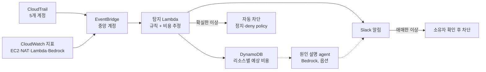

# [예시 제안서] 훈련용 AWS 환경 비용 최적화

2026-09-20 · 송무현

> 원본: `Example_Proposal_Cost_Anomaly_Detection.pdf` (6쪽)

[CFP](WorldSkills_CloudComputing_Project_Track_CFP.md#4-제안서-제출-요건) 4장 요건에 맞춘 예시로, 트랙 A의 예시 주제 "비용 이상 1시간 내 차단"을 골랐다고 가정했습니다. 모든 수치는 설명을 위한 가상 값이며, 실제 제안서에서는 본인이 측정한 값을 씁니다.

## 1. 제목 / 트랙

| 항목 | 내용 |
|---|---|
| 제목 | 훈련용 AWS 계정 5개의 비용 이상을 1시간 안에 탐지하고 원인 리소스까지 차단하는 시스템 |
| 트랙 | A. Cost Optimization (FinOps), AI Agent 확장 포함 |
| Project Lead | 선수 1번 |
| Reviewer | 선수 3번, 4번 |

## 2. 문제 정의

훈련팀이 쓰는 AWS 계정 5개(개인 계정 4개, 공용 계정 1개)에서는 지난 1년간 비용 급증 사고가 네 번 있었고, 가장 큰 사고는 연습 중 만든 NAT Gateway와 대형 instance를 주말 동안 방치해 하루 만에 $180이 나온 경우였습니다. AWS Budgets 알림은 하루 한 번 이상 갱신되는 청구 데이터를 기준으로 하기 때문에, 알림을 받았을 때는 이미 몇 시간에서 하루치 비용이 쌓인 뒤입니다. 또 알림은 "비용이 늘었다"만 알려줄 뿐, 어느 계정의 어떤 리소스 때문인지는 사람이 console을 뒤져야 합니다. 청구 데이터보다 빠른 신호(CloudTrail 이벤트, CloudWatch 지표)로 이상을 잡고 원인 리소스까지 특정하면 피해를 1시간치 이내로 줄일 수 있습니다. 개발·테스트 계정을 많이 운영하는 회사도 똑같이 겪는 문제입니다.

## 3. 목표와 최종 지표

비용 이상이 시작된 뒤 1시간 안에 원인 리소스를 특정해 차단하고, 정상적인 연습은 한 번도 방해하지 않는 것이 목표입니다.

### 정량 지표

| 지표 | 현재 | 목표 | 측정 방법 |
|---|---|---|---|
| 이상 발생 → 탐지 시간 | 약 24시간 (Budgets 알림) | 15분 이내 | 이상 시나리오 10종을 주입하고 주입 시각과 탐지 시각 비교 |
| 이상 발생 → 차단 시간 | 수동, 평균 30시간 | 60분 이내 | 같은 시나리오에서 차단 완료 시각 |
| 원인 리소스 특정 정확도 | 없음 (사람이 추적) | 10종 중 9종 이상 | 탐지 결과와 실제 주입 리소스 비교 |
| 오탐으로 연습이 중단된 횟수 | — | 4주 운영 중 0회 | 차단 log와 선수 신고 |

### 정성 지표

- 이상 유형별 대응 runbook, 그리고 "자동 차단"과 "사람 승인 후 차단"을 나누는 판단 기준 문서
- 계정 사용자 피드백: 알림이 이해하기 쉬운지, 원인 설명이 충분한지

### Scope

- **Must**: 5개 계정의 이상 탐지·원인 특정·차단, 이상 시나리오 주입 test suite
- **Nice-to-have**: 원인 설명 agent, 주간 비용 리포트
- **Out of scope**: rightsizing 같은 상시 비용 절감, Savings Plans 구매

## 4. 접근 방법

청구 데이터를 기다리지 않고, 비용을 만드는 행동(CloudTrail 이벤트)과 사용량(CloudWatch 지표)을 실시간 신호로 씁니다. 청구 데이터(CUR)는 사후 검증과 추정치 보정에만 씁니다.

점선은 Agent 확장 경로이며, 없어도 탐지·차단은 그대로 동작합니다.

| 결정 | 선택 | 이유 |
|---|---|---|
| 이상 신호 | CloudTrail 생성 이벤트 + CloudWatch 사용량 지표 | 청구 데이터보다 훨씬 빨리 들어옴 |
| 비용 추정 | 리소스 생성 시 Price List API로 시간당 단가를 조회해 누적 | 청구서가 나오기 전에 "지금 얼마씩 새고 있는지" 계산 |
| 차단 방식 | 확실한 이상은 자동(instance 정지, deny policy), 애매하면 리소스 소유자 확인 후 차단 | 오탐으로 연습을 끊지 않기 위해 |
| 계정 구조 | AWS Organizations + 중앙 계정으로 이벤트 집계 | 5개 계정을 한 곳에서 판단 |

### AI Agent 활용과 사전 학습 적용

- **역할**: 탐지된 이상마다 CloudTrail·지표·예상 비용을 읽고 "무엇이, 누구에 의해, 왜 늘었는지"를 설명합니다. 차단 권한은 없고 read-only입니다.
- **AI Capabilities and Limitations**: agent 설명이 틀릴 수 있다는 전제로, 차단 결정은 규칙 기반 로직이 하고 agent는 설명만 맡습니다.
- **Introduction to MCP**: CloudWatch와 Linear를 MCP tool로 연결해, 이상마다 Linear Issue를 자동으로 만들고 설명을 붙입니다.
- **Building Effective Human-Agent Teams**: "애매한 이상은 리소스 소유자가 확인"하는 흐름을 사람과 agent의 역할 분담 기준으로 설계합니다.
- **비교 방법**: 선수 4명이 agent 설명이 있을 때와 없을 때 원인을 파악하는 데 걸린 시간을 비교합니다.

## 5. 예상 비용

프로젝트 자체의 운영 비용은 월 $10 미만으로 예상하며, 값은 AWS Pricing Calculator로 다시 확인해 제출합니다.

| 항목 | 월 예상 비용 (USD) |
|---|---|
| EventBridge (계정 간 이벤트 전달) | 1 미만 |
| Lambda + DynamoDB | 1 미만 |
| CloudWatch 알람·지표 | 약 3 |
| Amazon Bedrock (옵션, Claude Haiku 4.5, 이상 발생 시에만 호출) | 약 1–2 |
| 이상 시나리오 주입 test | 별도 예산 10 |
| 합계 (test 제외) | 약 5–7 |

**Bedrock 비용 한도** (CFP 8장 설정 적용)

- IAM policy로 Claude Haiku 4.5만 호출할 수 있게 제한
- `Owner=선수1`, `Project=cost-anomaly` tag를 붙인 application inference profile로만 호출
- CloudWatch token 지표로 일일 20만 token 한도 알람, 초과 시 Lambda가 deny policy 부착
- AWS Budgets action으로 Bedrock 월 $5의 80%에서 알림, 100%에서 호출 차단

프로젝트 전체에는 월 $20 예산을 걸고, 80%에서 알림이 가도록 합니다.

## 6. 예상 리스크

가장 큰 리스크는 자동 차단이 정상 연습을 끊는 것이어서, 처음 2주는 알림만 보내는 dry-run으로 운영합니다.

| 리스크 | 영향 | 대응 |
|---|---|---|
| 오탐으로 연습 중인 리소스 차단 | 선수 연습 중단 | 처음 2주 dry-run, 자동 차단은 확실한 유형만, `keep=true` tag 예외 |
| 추정 비용과 실제 청구 차이 | 이상 판단 오류 | 매주 CUR로 추정치와 실제 비용을 비교해 보정 |
| 자동 차단 권한 자체의 위험 | 잘못된 조치 | 삭제는 하지 않고 정지·deny policy만, 모든 조치는 되돌릴 수 있게 하고 log 저장 |
| 이상 시나리오 주입 비용 | test 비용 증가 | 작은 instance로 짧게 주입, test 전용 예산 $10 |

## 7. 학습 계획

탐지·차단에 필요한 계정 간 이벤트 처리와 실시간 비용 추정은 처음 다루는 영역이라, 구현 전 첫 2주를 아래 학습에 씁니다. 공부한 내용은 engineering log에 `학습` tag로 남깁니다.

| 기술·서비스 | 현재 수준 | 필요한 이유 | 공부 방법 |
|---|---|---|---|
| AWS Organizations, 계정 간 EventBridge | console로 계정 만들기만 해 봄 | 5개 계정의 이벤트를 중앙 계정으로 모으기 위해 | 공식 문서, 테스트용 organization에서 실습 |
| CloudTrail 이벤트 구조 | log를 열어 본 정도 | 어떤 API 호출이 비용을 만드는지 판별 | 비용이 드는 생성 이벤트(RunInstances, CreateNatGateway 등) 목록 직접 정리 |
| AWS Price List API | 처음 | 리소스 시간당 단가를 조회해 실시간 비용 추정 | API 문서, EC2·NAT Gateway 단가를 조회하는 작은 script |
| CUR 2.0 + Athena | 처음 | 추정치와 실제 청구 비교 | 공식 문서, 1주치 데이터로 query 연습 |
| Amazon Bedrock, MCP | 사전 학습 강좌만 수강 | 원인 설명 agent 구현과 Linear 연결 | Claude with Amazon Bedrock 강좌 중 agent·tool use 부분, MCP 강좌 실습 반복 |

## AI 사용 내역

| 항목 | AI를 쓴 방식 | 받아들인 것 / 버린 것과 이유 |
|---|---|---|
| 2. 문제 정의 | 직접 초안을 쓴 뒤 반론을 요청 | "Budgets 알림으로 충분하지 않냐"는 반론을 받아, 청구 데이터 갱신 주기와 실제 사고 사례를 근거로 추가 |
| 4. 접근 방법 | 대안 architecture를 제안받음 | Cost Anomaly Detection 중심 설계를 제안받았지만, 청구 데이터 기반이라 1시간 목표에는 느리다고 판단해 보조 수단으로만 채택 |
| 5. 예상 비용 | 비용 표 초안 작성 | 항목 구성은 사용, 금액은 Pricing Calculator로 직접 다시 계산 |

## 참고: 초기 Linear 구성 (선택)

제안서 필수 항목은 아니지만, 승인 후 Linear Project 하나를 만들고 3장의 성공 기준을 아래처럼 Milestone과 Issue로 옮겨 시작합니다.

| Milestone | 대표 Issue |
|---|---|
| 1. 이상 시나리오 test suite | 이상 10종 정의, 주입 script, 현재 탐지 시간 측정 |
| 2. 실시간 탐지 | Organizations 이벤트 집계, 탐지 규칙, Price List 기반 비용 추정 |
| 3. 차단과 승인 흐름 | 자동 차단 대상 정의, Slack 승인, 2주 dry-run |
| 4. 검증 | 10종 주입 test, CUR 대조, 4주 운영 |
| 5. 원인 설명 agent (옵션) | Bedrock 비용 한도 설정, agent 구현, agent 유무 비교 |

Issue는 이 프로젝트의 team key를 붙여 `COST-12`처럼 번호가 매겨지고, 같은 ID를 branch 이름에 넣어 Pull Request와 연결합니다.
